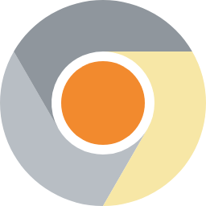

<p align="center"></p>

# Cerium Browser

Cerium is a web browser built on [ungoogled-chromium](https://github.com/ungoogled-software/ungoogled-chromium),
with three additions:

- **A "Use Google services" switch.** It is off by default, so Cerium behaves exactly like
  ungoogled-chromium and doesn't contact Google on its own. Turning it on brings back the
  Google integrations that work without Google's private API keys.
- **uBlock Origin built in.** This is the full Manifest V2 version (1.75.0), not uBlock Origin Lite.
- **Dark Reader built in** (4.9.133).

Releases have builds for:

- **Linux** (x86_64 and arm64): `.AppImage` and `.tar.xz`;
- **macOS on Apple Silicon** (M-series chips): `.dmg`. See [Installing on macOS](#installing-on-macos).

Base: Chromium 156.0.8078.47 with ungoogled-chromium at commit `8025d45`, the commit its
macOS release uses. The build harnesses are taken from
[ungoogled-chromium-portablelinux](https://github.com/ungoogled-software/ungoogled-chromium-portablelinux)
(Linux) and [ungoogled-chromium-macos](https://github.com/ungoogled-software/ungoogled-chromium-macos)
(macOS) at their 156.0.8078.47 releases.

## Installing on macOS

For Macs with an M-series chip, macOS 13 Ventura or later:

1. Download `cerium-<version>-arm64-macos.dmg` from the
   [latest release](https://github.com/Voynich000/cerium-browser/releases/latest).
2. Open it and drag **Cerium** onto **Applications**.
3. Open Cerium. The first time, macOS asks whether to open an app downloaded from the internet;
   click **Open**.

uBlock Origin and Dark Reader are already installed and pinned to the toolbar.

This is how it works for releases that are signed with an Apple Developer ID and notarized by
Apple (see [Releases that open with a double-click](#releases-that-open-with-a-double-click)). A
release made without the Apple signing secrets says so in its notes, and macOS blocks it the first
time: open Cerium once, then go to **System Settings → Privacy & Security** and click
**Open Anyway**. Or run `xattr -dr com.apple.quarantine /Applications/Cerium.app` in Terminal.

## The Google services switch

Find it in **Settings → System → Google services → Use Google services**. Flip it and press
**Relaunch**. You can also force it from the command line with
`--enable-features=GoogleServices` or `--disable-features=GoogleServices`; this overrides the setting.

| | Off (default) | On |
|---|---|---|
| Install from the Chrome Web Store ("Add to Chrome") | blocked | works |
| Extension auto-updates | none | yes |
| Component updates: Widevine DRM (Netflix, Spotify, …), certificate revocation lists, etc. | none | yes |
| Spell-check dictionary downloads | none | yes |
| Google URLs built into the browser (help links, update servers, …) | blocked | go to the real Google host |

When the switch is on, the browser behaves like Chromium for the features above. For example, it
sends the IDs and versions of your extensions to Google when it checks for updates.

### What the switch can't turn on

Some Google features can't come back. They either need Google API keys and OAuth clients,
which Google only issues for Google Chrome, or ungoogled-chromium removes them at compile time:

- Google account sign-in and Sync
- Safe Browsing (compiled out: `safe_browsing_mode=0`)
- Google Translate and push messaging (GCM)
- Google as a built-in search engine. ungoogled-chromium replaces it at build time. You can
  still add it under **Settings → Search engine → Manage search engines → Add**, with URL
  `https://www.google.com/search?q=%s`.

### How it works

ungoogled-chromium uses two techniques:

1. Its patches delete Google features from the code.
2. "Domain substitution" rewrites every Google hostname in the source to an unresolvable name
   (`clients2.google.com` → `clients2.9oo91e.qjz9zk`). The network stack then blocks those
   names with a `trk:` handler.

Cerium leaves both in place, so "off" is stock ungoogled-chromium, and adds a runtime switch on top:

- `net::kGoogleServices` is a `base::Feature`, so every process (browser, renderer,
  network service) sees the same state. The `google_services.enabled` local-state pref is
  turned into a feature override when the browser starts. That's why changing it needs a relaunch.
- `net::UnsubstituteHost()` exactly reverses `domain_regex.list`. While the switch is on:
  - the `trk:` handler answers with a 307 redirect to the real host instead of an error;
  - the browser recognises the Web Store by its real origin (`extension_urls`,
    `ChromeExtensionsClient`);
  - extension API `matches` patterns that domain substitution rewrote (such as
    `webstorePrivate`) also match the real hosts.
- The code that ungoogled-chromium deletes for the Web Store installer, extension updater,
  component updater and spell-check downloads is restored behind `IsGoogleServicesEnabled()`.

| Patch | What it does |
|---|---|
| `patches/cerium/add-google-services-switch.patch` | Feature, pref, startup hook, `UnsubstituteHost()` and its unit test |
| `patches/cerium/redirect-substituted-domains.patch` | `trk:` handler redirects instead of blocking |
| `patches/cerium/restore-chrome-web-store.patch` | Web Store origin, `webstorePrivate`, installer, process isolation |
| `patches/cerium/restore-extension-and-component-updates.patch` | Extension and component update checks |
| `patches/cerium/restore-spellcheck-downloads.patch` | Dictionary downloads |
| `patches/cerium/add-google-services-setting.patch` | The setting in chrome://settings/system |
| `patches/cerium/add-bundled-extensions.patch` | Installs the bundled extensions |

## Built-in uBlock Origin and Dark Reader

`utils/bundle_extensions.py` does the following for each extension in `extensions/extensions.json`:

1. Downloads the pinned release from GitHub and checks its SHA-256.
2. Packs it as a signed CRX3 file.
3. Writes it to `<install dir>/bundled_extensions/`.

`add-bundled-extensions.patch` makes the browser install everything in that folder on every
platform, without the usual "new extension added" prompt. It also writes `initial_preferences`
so that both extensions are pinned to the toolbar in new profiles.

The extensions remain ordinary extensions:

- You can open their popups, change their settings, and disable or remove them in
  chrome://extensions. A removal is remembered.
- New versions arrive with browser updates.
- uBlock Origin updates its filter lists by itself, from the list maintainers rather than Google.

uBlock Origin needs Manifest V2. ungoogled-chromium's `extensions-manifestv2.patch` keeps MV2
working; stock Chrome refuses to install it.

One tweak is applied to Dark Reader: it no longer opens its help page when it is installed on
first run. Tweaks are listed in `extensions.json`, and the build fails if one no longer matches.

### Signing keys: keep them

The extension ID is derived from the key that signs the CRX file. The browser stores each
extension's settings under its ID. If the key changes, users get a "new" uBlock Origin or Dark
Reader and lose their settings.

- **Local builds:** the first build creates `keys/ublock_origin.pem` and `keys/dark_reader.pem`.
  Git ignores them. Back them up.
- **CI:** store them as repository secrets:

  ```sh
  gh secret set CERIUM_UBLOCK_ORIGIN_KEY < keys/ublock_origin.pem
  gh secret set CERIUM_DARK_READER_KEY < keys/dark_reader.pem
  ```

  The Linux workflow signs the extensions in its packaging step at the very end of a build, and
  the macOS one when it publishes the disk image. A secret added while a build is running is
  still used. Without the secrets, a build creates new keys and warns.

Never publish the keys. Anyone holding them can produce extensions with the same IDs.

## Branding

The browser calls itself Cerium everywhere it names itself: the window title, the About page,
Settings, menus, dialogs and error pages, in all 81 languages.

- `utils/rebrand.py` runs at build time, after domain substitution. It renames the product in
  Chromium's branded string files (`chromium_strings.grd`, `settings_chromium_strings.grdp`,
  `components_chromium_strings.grd`) and in the product names in `BRANDING`.
- Translations are matched to English strings by a fingerprint of the English text. The script
  uses Chromium's own resource tool (grit) to compute each changed string's new fingerprint and
  moves its translations over, renaming the product in them too. It stops the build if any
  translation would be lost.
- `patches/cerium/rebrand-linux-identity.patch` gives Cerium its own Linux identity:
  - profile in `~/.config/cerium` and cache in `~/.cache/cerium`, so it never shares a profile
    with an installed Chromium;
  - `cerium.desktop` as the desktop file, which also sets the window class;
  - `cerium` as the icon name.

Some things deliberately still say Chromium:

- "The Chromium Authors" in the copyright notice on the About page, because that's who holds
  the copyright;
- "Chromium developers" on chrome://internals pages;
- the user agent, which stays the standard Chrome one so websites keep working.

### Logo

The logo is Chromium's own logo in Cerium's colours:

| Part | Chromium | Cerium |
|---|---|---|
| Top segment | dark blue `#1967D2` | silver-gray `#8F969D` |
| Lower-left segment | blue `#669DF6` | light silver-gray `#B8BEC4` |
| Right segment | light blue `#AECBFA` | pale yellow `#F7E7A6` |
| Centre | blue `#1A73E8` | orange `#F28A2E` |
| Ring | white | white |

`branding/cerium/logo.svg` and `logo-animation.svg` are Chromium's `product_logo.svg` and
`product_logo_animation.svg` with those colours swapped. `branding/render.js` renders them into
`branding/overlay/`, which mirrors 29 logo files in the Chromium source tree:

- app icons from 16 to 256 px, at 1× and 2×;
- the "cerium" wordmarks, in dark and white, using the Inter Display font;
- the favicon and the SVG logos.

The monochrome tray icon stays Chromium's, since it is already grey.

`utils/rebrand.py` copies the overlay in at build time and stops the build if a Chromium update
moved or resized any of those files. The rendered PNGs are committed, so building needs no
renderer; run `node branding/render.js` only after changing the SVGs.

## Building (Linux)

Requirements:

- A Linux x86_64 or arm64 machine with Docker
- About 16 GB of RAM (32 GB is better) and 100 GB of free disk space
- Time: a full Chromium build takes several hours even on 8–16 cores

```sh
git clone --recurse-submodules <this repository> cerium-browser
cd cerium-browser
scripts/docker-build.sh        # fetch, prune, patch, domain substitution, build, bundle extensions
package/docker-package.sh      # build/release/cerium-<version>-<arch>.AppImage and _linux.tar.xz
```

`scripts/docker-build.sh` builds a Debian image with the toolchain and runs `scripts/build.sh`
inside it. `scripts/build.sh` takes these steps:

1. Downloads the Chromium source tarball.
2. Removes prebuilt binaries.
3. Applies ungoogled-chromium's patches, then `patches/series`. That's the portablelinux build
   fixes followed by Cerium's patches.
4. Runs domain substitution.
5. Renames the browser to Cerium and swaps in its logos (`utils/rebrand.py`).
6. Runs `utils/bundle_extensions.py`.
7. Builds `chrome`.

## Building (macOS)

`macos/` is Cerium's copy of the ungoogled-chromium-macos harness. Its patch series
(`macos/patches/series`) is the macOS build fixes, then Cerium's shared patches, then two
macOS-only ones in `macos/patches/cerium-macos/`:

- the bundle identifier `io.github.voynich000.cerium`;
- the `~/Library/Application Support/Cerium` profile, plus reading `initial_preferences` from
  inside the app.

On an Apple Silicon Mac with Xcode 26 and Homebrew:

```sh
brew install go ninja coreutils esbuild typescript
pip3 install httplib2 cryptography --break-system-packages
macos/build.sh arm64           # clones Chromium, patches, builds, packages build/cerium-*.dmg
```

The build renames the app (`Cerium.app`) and recompiles the Dock icon's asset catalog with Xcode's
`actool`. Then `macos/package_dmg.sh` copies the app, adds the bundled extensions, signs it
(`macos/sign_app.sh`) and makes the disk image. It signs ad hoc unless `MACOS_SIGNING_IDENTITY`
and the `MACOS_NOTARIZATION_*` variables are set (see `macos/sign_app.sh`).

## GitHub Actions

| Workflow | What it does |
|---|---|
| `build.yml` | Linux x86_64 and arm64 on the free Ubuntu runners |
| `build-macos.yml` | macOS Apple Silicon on the free `macos-15` (M1) runners; ends with `Cerium.app` as a build artifact |
| `release-macos.yml` | **Publish Cerium for macOS**: adds the extensions to a finished macOS build, signs and notarizes it, makes the `.dmg` and adds it to the release |
| `check.yml` | Checks the Linux and macOS patch series on every push and pull request |

The two build workflows split the build into a chain of jobs, each under GitHub's 6-hour job
limit, and pass the build tree between them. A Linux build takes roughly a day; a macOS build
on 3-core M1 runners can take longer.

Pushing a tag such as `156.0.8078.47-1` starts both builds. The Linux build adds its files to
the GitHub release for that tag. The macOS build ends by running `release-macos.yml`, which
adds the disk image, creating the release if there is none yet.

Started by hand from the Actions tab, a build only produces build artifacts. To release a
finished macOS build, run **Publish Cerium for macOS** from the Actions tab. It takes the latest
finished build (or the build run whose ID you enter), creates the release named after its version,
tag included, and adds the disk image. It takes a few minutes, plus Apple's notarization time.
Running it again replaces the disk image, for example after adding the Apple signing secrets.

## Releases that open with a double-click

macOS only opens a downloaded app without complaint if it is signed with an Apple Developer ID
certificate and notarized by Apple. That needs a membership of the
[Apple Developer Program](https://developer.apple.com/programs/) (99 USD a year); there is no
free way around it. Without it, releases are signed ad hoc and users have to allow Cerium in
System Settings the first time.

Once you're a member:

1. **Create the certificate.** On a Mac, open Xcode → Settings → Accounts, select your team,
   click **Manage Certificates**, click **+** and choose **Developer ID Application**. Then in
   Keychain Access, under **My Certificates**, right-click "Developer ID Application: *your name*
   (*team ID*)", choose **Export**, and save it as a `.p12` file with a password.
2. **Create an app-specific password** for your Apple ID at
   [account.apple.com](https://account.apple.com) → Sign-In and Security → App-Specific
   Passwords. Notarization uses it.
3. **Add five repository secrets** (Settings → Secrets and variables → Actions):

   | Secret | Value |
   |---|---|
   | `MACOS_CERTIFICATE` | the `.p12` file, base64-encoded: `base64 -i certificate.p12 \| pbcopy` copies it |
   | `MACOS_CERTIFICATE_PASSWORD` | the password you exported it with |
   | `MACOS_NOTARIZATION_APPLE_ID` | your Apple ID e-mail address |
   | `MACOS_NOTARIZATION_TEAM_ID` | your team ID: the 10 characters in brackets in the certificate's name |
   | `MACOS_NOTARIZATION_PASSWORD` | the app-specific password |

4. Run **Publish Cerium for macOS** to replace the disk image of the latest release, or wait for
   the next tag.

The publish workflow signs every part of the app with the hardened runtime and Chromium's
entitlements, sends it to Apple's notary service, staples the ticket to the app and checks it the
way Gatekeeper does. If any of that fails, the workflow stops before uploading anything.

`check.yml` takes about 15 minutes per platform. It runs the tooling tests and applies the
whole patch stack, domain substitution and the Cerium rename to the real Chromium source
(`scripts/check-patches.sh`). You can run that script locally too; it needs python3, GNU patch
and about 20 GB of disk. Set `CERIUM_PATCHES_DIR=macos/patches` to check the macOS series.

## Updating

1. Move the `ungoogled-chromium` submodule to the new release. Use the commit that the new
   ungoogled-chromium-macos release pins, so both platforms share it.
2. Copy that release's patches and series entries from ungoogled-chromium-portablelinux into
   `patches/ungoogled-chromium/portablelinux/` and `patches/series`. Do the same from
   ungoogled-chromium-macos into `macos/patches/`; also refresh its scripts, `.ini` files and
   `.github/workflows/building.yml` (as `build-macos-steps.yml`). Its `sign_and_package_app.sh`
   is split into `macos/sign_app.sh` and `macos/package_dmg.sh`.
3. Refresh `patches/cerium/*.patch` if they no longer apply. They are small and each has a
   description header.
4. Run `python3 utils/check_domain_unsubstitution.py`. Add `--source-tree <chromium src>` for
   the full check. This catches changes to `domain_regex.list`.
5. To update an extension, change `version`, `url` and `sha256` in `extensions/extensions.json`.
   Check that its tweaks still apply.

## What has been verified

- Both patch stacks apply cleanly to the Chromium 156.0.8078.47 source tarball, each followed by
  domain substitution and the Cerium rename. Each step uses ungoogled-chromium's own tools.
  - Linux: binary pruning, ungoogled-chromium's 110 patches, the portablelinux patches, then
    Cerium's patches.
  - macOS: ungoogled-chromium's patches, the macOS build fixes, Cerium's shared patches, then
    the macOS-only ones.
  - The Linux check also passed on GitHub Actions.
- `UnsubstituteHost()` was checked against every substituted hostname in the Chromium 156
  source, about 1,700 cases, with no mismatches. Its gtest passes against Chromium's bundled
  googletest.
- The CRX3 packer was tested in a real Chromium (Chrome for Testing 153):
  - the bundled Dark Reader installed with no prompt, enabled and pinned;
  - uBlock Origin's CRX was accepted, then refused only because stock Chrome has no MV2.
- The changed Settings TypeScript files parse cleanly.
- `utils/rebrand.py` was run on the real Chromium 156 strings. It renamed 611 messages and
  moved about 46,000 translations to their new fingerprints, with none lost. Spot checks in
  German, Japanese, Chinese, Russian, Arabic and Hindi show "Cerium". A second run changes
  nothing.
- **Not done yet: compiling.** A Chromium build needs about 100 GB and hours of CPU time, so the
  C++ and TypeScript changes have not been compiled. They were written against the exact
  Chromium 156 sources, but the first CI build is the real test. The macOS workflows and the
  `actool` step have not run on a Mac yet. The signing and notarization code is
  ungoogled-chromium-macos's, which its own releases use.

## Platforms

- **Linux:** x86_64 and arm64.
- **macOS:** Apple Silicon. The macOS harness can also build x86_64 (`macos/build.sh x86_64`),
  but releases are Apple Silicon only.
- **Windows:** not supported yet. The patches aren't platform-specific, but a build would need the
  ungoogled-chromium-windows harness, and Windows `.ico` icons in `branding/overlay/`.

## Repository layout

```
patches/series                 patch order (portablelinux fixes, then Cerium)
patches/cerium/                Cerium's Chromium patches
patches/ungoogled-chromium/    Linux build fixes from ungoogled-chromium-portablelinux
extensions/extensions.json     pinned uBlock Origin / Dark Reader releases
extensions/licenses/           their licenses (shipped with the browser)
utils/bundle_extensions.py     download, verify, sign and stage the extensions
utils/crx3.py                  CRX3 packer and verifier
utils/check_domain_unsubstitution.py  checks UnsubstituteHost() against domain_regex.list
utils/test_crx3.py             tests for the CRX3 packer
utils/rebrand.py               renames Chromium to Cerium in the UI strings, applies the logos
branding/cerium/               recoloured logo SVGs and large PNGs
branding/overlay/              rendered logos, mirroring their paths in the Chromium tree
branding/render.js             renders the overlay from the SVGs
scripts/check-patches.sh       applies all patches without building
branding/make_macos_icons.py   recolours the macOS icon layers and builds app.icns
scripts/, docker/, package/    Linux build and packaging (from portablelinux)
macos/                         macOS build and packaging (from ungoogled-chromium-macos)
.github/                       CI (from portablelinux and ungoogled-chromium-macos)
ungoogled-chromium/            submodule, pinned to 8025d45 (156.0.8078.47, revision 1)
```

## License

The patches and scripts are BSD-3-Clause; see [LICENSE](LICENSE). Chromium, ungoogled-chromium
and the bundled extensions keep their own licenses: uBlock Origin is GPL-3.0-or-later and Dark
Reader is MIT.
